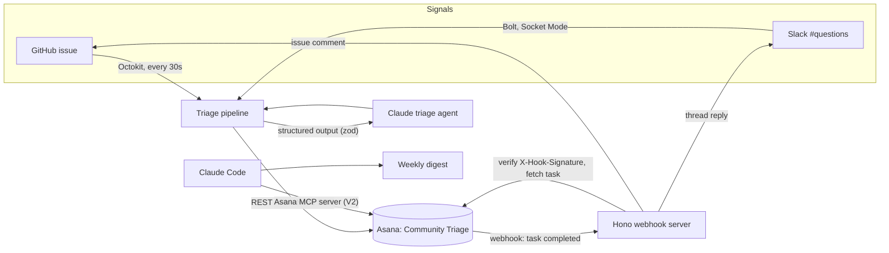

# community-signals-asana

Turn developer community signals into triaged Asana tasks, and tell people when their issue is done.

A GitHub issue or a Slack question comes in. An AI agent classifies it, writes a clear title and summary, and creates an Asana task in the right section with Source, Signal type and Priority filled in. When someone completes the task in Asana, the app replies on the original issue or thread. Once a week, Claude reads the same project through Asana's MCP server and drafts a community update.

<!-- Demo GIF: docs/demo.gif -->

## How it works



1. **Signals arrive.** New issues on one GitHub repo (polled with Octokit) and new top-level messages in one Slack channel (Bolt over Socket Mode, so Slack needs no public URL).
2. **The agent triages.** One Claude call per signal returns a zod-validated result: type (bug, docs gap, question, feature request, contributor to thank), priority, title and summary. It can also skip spam and duplicates, or mark the signal as not confident.
3. **Asana gets a task** in the section for its type, or in **Needs review** when the agent isn't sure, with Source, Signal type, Priority and Source URL set.
4. **The loop closes.** An Asana webhook fires when a task is completed. The server checks the signature, fetches the task, and replies on the GitHub issue or in the Slack thread.
5. **The weekly digest.** Claude Code reads the project through [Asana's MCP server](https://developers.asana.com/docs/using-asanas-mcp-server) and writes a community update. See [digest/](digest/).

## Quick start

You need Node 20.12+, a free Asana account, a GitHub repo to watch, an [Anthropic API key](https://platform.claude.com/settings/keys) and [cloudflared](https://developers.cloudflare.com/cloudflare-one/connections/connect-networks/downloads/) (or ngrok).

```bash
git clone https://github.com/MattBibi/asana-sandbox.github.io community-signals-asana
cd community-signals-asana
npm install
cp .env.example .env
```

1. **Fill in `.env`:**
   - `ASANA_PAT`: a [personal access token](https://app.asana.com/0/my-apps).
   - `GITHUB_TOKEN`: a [fine-grained token](https://github.com/settings/personal-access-tokens/new) for your repo with **Issues: read and write**.
   - `GITHUB_REPO`: the repo to watch, as `owner/name`.
   - `ANTHROPIC_API_KEY`.
2. **Create a project named "Community Triage"** in Asana, then build its sections and fields:
   ```bash
   npm run setup
   ```
   This is safe to re-run; anything that already exists is left alone.
3. **Start everything** (webhook server, GitHub poller, and Slack if configured):
   ```bash
   npm start
   ```
4. **Give Asana a way to reach you.** In a second terminal:
   ```bash
   cloudflared tunnel --url http://localhost:3000
   ```
   Then register the webhook with the `https://….trycloudflare.com` URL it prints:
   ```bash
   npm run webhook:register -- https://your-tunnel.trycloudflare.com
   ```

Now open an issue on your repo. Within a minute it becomes a task in Asana. Complete the task, and a reply appears on the issue a few seconds later.

**Optional: Slack.** Create an app at [api.slack.com/apps](https://api.slack.com/apps) → *From a manifest* → paste [slack-app-manifest.yml](slack-app-manifest.yml). Install it, create an app-level token with `connections:write`, set `SLACK_BOT_TOKEN` and `SLACK_APP_TOKEN`, invite the bot to `#questions`, and restart `npm start`.

## Scripts

| Command | What it does |
| --- | --- |
| `npm start` | Runs the webhook server, the GitHub poller and the Slack listener |
| `npm run setup` | Creates the Asana sections and custom fields (safe to re-run) |
| `npm run webhook:register -- <url>` | Points the Asana webhook at your public URL, replacing old ones |
| `npm run try:triage` | Runs the agent on 7 sample signals, with no GitHub, Slack or Asana, and reports the cost |
| `npm run poll -- --once` | One pass over the GitHub repo, then exit |
| `npm run digest` | Writes this week's community update through Asana's MCP server |
| `npm run typecheck` | Type-checks the project |

## Design choices

- **The agent can't put free text into Asana.** Structured outputs check every response against a zod schema built from [one taxonomy file](src/taxonomy.ts), the same one that creates the Asana dropdowns. A type or priority can only be a value that exists.
- **Signal text is untrusted.** Issues and messages are written by the public, so they go to the model as material to classify, and it's told to ignore instructions inside them. [One of the samples](scripts/samples.ts) is a prompt injection; it stays low priority and the summary flags it.
- **Webhooks are verified.** The server echoes `X-Hook-Secret` during the handshake, keeps the secret out of the repo, and checks `X-Hook-Signature` (HMAC-SHA256 of the raw body, constant-time compare) on every event. Unsigned or forged calls get a 401.
- **Replies are idempotent.** Asana can redeliver events, and tasks can be reopened. A hidden marker (an HTML comment on GitHub, message metadata on Slack) means each task gets one reply, ever.
- **Replies only go where they should.** Anyone in Asana can edit the Source URL field, so the app only replies on the configured repo and Slack channel. The reply text is fixed; nothing from Asana comments, which can be internal, is copied to a public place.
- **No duplicate tasks.** Each task stores its Source URL, so restarts and reopened issues don't create a second task. The agent also sees open task titles to catch near-duplicates.
- **Costs stay visible and bounded.** Triage runs Claude Opus 5.5 at low effort, about $0.008 per signal. Each pass logs its cost, and a failing issue is retried after 1 minute and 5 minutes, then dropped, so a stuck issue can't keep calling the model.

## Project layout

```
src/
  main.ts             npm start: wires everything together
  taxonomy.ts         signal types, sources, priorities: one source of truth
  triage.ts           the Claude triage agent (structured output)
  pipeline.ts         signal → triage → Asana task
  asana.ts            typed wrapper over the official asana Node SDK
  triage-project.ts   finds (or, in setup, creates) sections and fields
  github.ts           Octokit: read issues, comment on them
  github-poller.ts    polling loop with retry limits
  slack.ts            Bolt (Socket Mode): read messages, reply in threads
  server.ts           Hono: Asana webhook handshake, signatures, events
  close-the-loop.ts   on completion, reply on GitHub or Slack, once
  webhook-secret.ts   stores the webhook secret, verifies signatures
scripts/              setup, sample runs, webhook registration, digest
digest/               MCP digest prompt and generated examples
```

## Before using this for real

This is a demo sized for one repo and one channel. For production I'd:

- Use Asana OAuth and a GitHub App or bot account instead of personal tokens, so replies come from "Community Bot" rather than a person.
- Receive GitHub issues by webhook instead of polling, and host the server behind a stable URL rather than a quick tunnel.
- Keep state (skipped signals, retry counts) in a small database so it survives restarts.
- Add tests around the signature check and the idempotency markers, and an eval set for triage quality.
